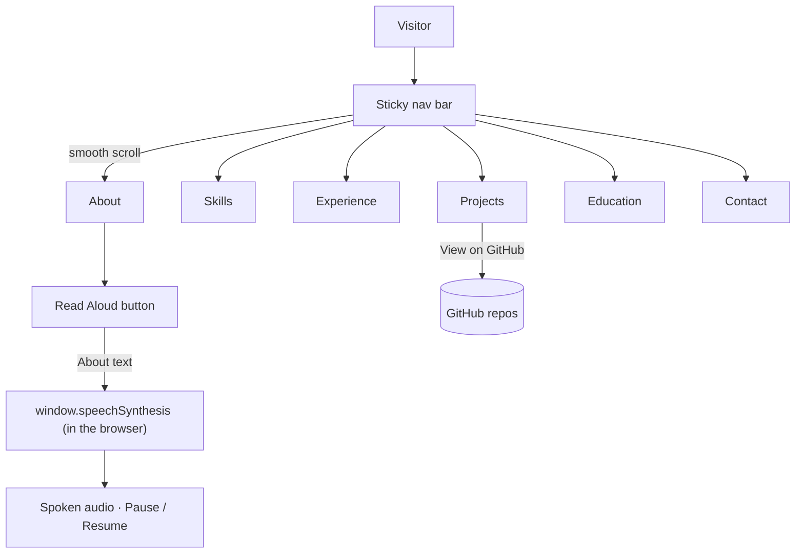

# 💼 Jayanth Gonugunta Venkata | Portfolio

> A single-page, dependency-free personal portfolio for an AI/ML-focused Computer Science graduate. It covers skills, experience, projects, education and contact details, in a dark, animated UI.

[](https://jayanth-gonugunta-venkata.netlify.app/)


🔗 **Live:** https://jayanth-gonugunta-venkata.netlify.app/

---

## ✨ Features

- **Single self-contained HTML file**: all CSS and JavaScript are inline; no build step or framework.
- **Sections**: About (career objective, core expertise, mission) · Skills & Technologies · Professional Experience · Real-Time Projects · Education · Contact.
- **Sticky, blurred top bar** with smooth-scroll navigation to each section.
- **Scroll-reveal animations** using `IntersectionObserver` (`.fade-in` → `.visible`).
- **Mouse-driven parallax** on the SVG grid / gradient background.
- **Skill icon grid** grouped into Programming Languages, AI/ML, Data Visualization, Cloud & DevOps, Development Tools and Soft Skills, using version-pinned SVG icons from [Devicon](https://devicon.dev/) (via jsDelivr) and [Iconify](https://iconify.design/), with no hot-linked third-party images.
- **Project cards** linking to their repositories under [github.com/Gonugunta-Venkata-Jayanth](https://github.com/Gonugunta-Venkata-Jayanth) and a Google Drive write-up.
- **"Read Aloud" button** in the About section: reads the About text with the browser's built-in [Web Speech API](https://developer.mozilla.org/docs/Web/API/SpeechSynthesis) (`speechSynthesis`), with Pause / Resume. No API key, server or network call is needed; it prefers an `en-IN` voice when the browser has one, and the button hides itself in browsers without speech synthesis.
- **Responsive layout** with a mobile media query.

## 🛠 Tech Stack

| Area | Tools |
|---|---|
| Markup / styling | HTML5, CSS3 (flexbox, gradients, `backdrop-filter`, keyframe animations) |
| Scripting | Vanilla JavaScript (`IntersectionObserver`, `speechSynthesis`) |
| Icons | [Devicon](https://devicon.dev/) v2.18.0 via jsDelivr, [Iconify](https://iconify.design/) |
| Text-to-speech | Browser Web Speech API (`speechSynthesis`) |
| Hosting | Netlify |

## 🏗 Page Flow



## 📂 Project Structure

```
Portfolio/
├── index.html               # The whole site: markup, styles and scripts
├── jayanth_portfolio.html   # Redirect stub to index.html (keeps old links working)
├── Jayanth.jpg              # Profile photo used in the About section
└── README.md
```

## 🚀 Run Locally

No dependencies. Either open the file directly:

```bash
git clone https://github.com/Gonugunta-Venkata-Jayanth/Portfolio.git
cd Portfolio
open index.html          # Windows: start index.html · Linux: xdg-open index.html
```

…or serve it (recommended, so relative paths behave as in production):

```bash
python -m http.server 8000
# then visit http://localhost:8000/
```

## ☁️ Deploy

The live site is hosted on **Netlify**: https://jayanth-gonugunta-venkata.netlify.app/

The site is published as `index.html`, which Netlify and GitHub Pages serve at the root URL with no extra configuration. To redeploy, connect this repository in Netlify (Site configuration → Build & deploy → Link repository; no build command, publish directory `/`) so every push to `main` deploys automatically, or drag the folder into Netlify's deploy UI.

## 🔮 Future Work

- Add Open Graph / SEO meta tags, a favicon and a downloadable résumé.
- Add projects that aren't listed yet (e.g. DeepCSAT, Shortest Path Finder).
- Self-host the icon SVGs in the repo so the page has no external image dependencies at all.

## 👤 Author

**Jayanth Gonugunta Venkata**: [github.com/Gonugunta-Venkata-Jayanth](https://github.com/Gonugunta-Venkata-Jayanth) · [LinkedIn](https://linkedin.com/in/gv-jayanth) · [Portfolio](https://jayanth-gonugunta-venkata.netlify.app/)
