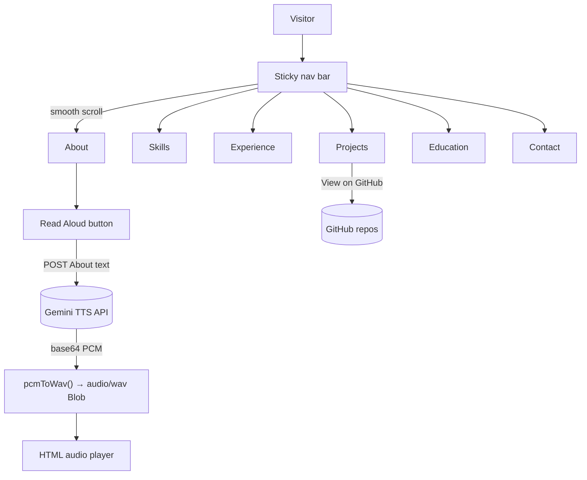

# 💼 Jayanth Gonugunta Venkata | Portfolio

> A single-page, dependency-free personal portfolio for an AI/ML-focused Computer Science graduate. It covers skills, experience, projects, education and contact details, in a dark, animated UI.

[](https://jayanth-gonugunta-venkata.netlify.app/)


🔗 **Live:** https://jayanth-gonugunta-venkata.netlify.app/

---

## ✨ Features

- **Single self-contained HTML file**: all CSS and JavaScript are inline; no build step or framework.
- **Sections**: About (career objective, core expertise, mission) · Skills & Technologies · Professional Experience · Real-Time Projects · Education · Contact.
- **Sticky, blurred top bar** with smooth-scroll navigation to each section.
- **Scroll-reveal animations** using `IntersectionObserver` (`.fade-in` → `.visible`).
- **Mouse-driven parallax** on the SVG grid / gradient background.
- **Skill icon grid** grouped into Programming Languages, AI/ML, Data Visualization, Cloud & DevOps, Development Tools and Soft Skills (Devicon CDN icons).
- **Project cards** linking to their GitHub repositories and a Google Drive write-up.
- **"Read Aloud" button**: sends the About text to the Google Gemini TTS API (`gemini-2.5-flash-preview-tts`, voice "Iapetus"), converts the returned PCM audio to WAV in the browser, and plays it with play / pause toggling. *Requires a Gemini API key. The key is left blank in the committed source.*
- **Responsive layout** with a mobile media query.

## 🛠 Tech Stack

| Area | Tools |
|---|---|
| Markup / styling | HTML5, CSS3 (flexbox, gradients, `backdrop-filter`, keyframe animations) |
| Scripting | Vanilla JavaScript (`IntersectionObserver`, `fetch`, `DataView` WAV encoding) |
| Icons | [Devicon](https://devicon.dev/) via jsDelivr CDN |
| Text-to-speech | Google Gemini API (TTS preview model) |
| Hosting | Netlify |

## 🏗 Page Flow



## 📂 Project Structure

```
Portfolio/
├── jayanth_portfolio.html   # The whole site: markup, styles and scripts
├── Jayanth.jpg              # Profile photo used in the About section
└── README.md
```

## 🚀 Run Locally

No dependencies. Either open the file directly:

```bash
git clone https://github.com/Gonugunta-Venkata-Jayanth/Portfolio.git
cd Portfolio
open jayanth_portfolio.html          # Windows: start jayanth_portfolio.html · Linux: xdg-open jayanth_portfolio.html
```

…or serve it (recommended, so relative paths and `fetch` behave as in production):

```bash
python -m http.server 8000
# then visit http://localhost:8000/jayanth_portfolio.html
```

### Enabling "Read Aloud" (optional)

Set `apiKey` in the `<script>` block of `jayanth_portfolio.html` to a Gemini API key from [Google AI Studio](https://aistudio.google.com/). Restrict the key to your site's domain (HTTP referrer restriction) before deploying, because any key placed in client-side JavaScript is visible to visitors.

## ☁️ Deploy

The live site is hosted on **Netlify**: https://jayanth-gonugunta-venkata.netlify.app/

To redeploy, drag the folder into Netlify's deploy UI or connect this repository. Netlify serves `index.html` at the root URL by default, so the site's HTML must be published as `index.html`.

## 🔮 Future Work

- Rename `jayanth_portfolio.html` to `index.html` so the repo deploys to Netlify or GitHub Pages with no extra configuration.
- Point the GitHub links at the current profile, `github.com/Gonugunta-Venkata-Jayanth`.
- Move the Gemini call behind a Netlify Function so no API key lives in the browser.
- Self-host skill icons that are currently hot-linked from third-party sites.
- Add Open Graph / SEO meta tags, a favicon and a downloadable résumé.
- Add projects that aren't listed yet (e.g. DeepCSAT, Shortest Path Finder).

## 👤 Author

**Jayanth Gonugunta Venkata**: [github.com/Gonugunta-Venkata-Jayanth](https://github.com/Gonugunta-Venkata-Jayanth) · [LinkedIn](https://linkedin.com/in/gv-jayanth) · [Portfolio](https://jayanth-gonugunta-venkata.netlify.app/)
